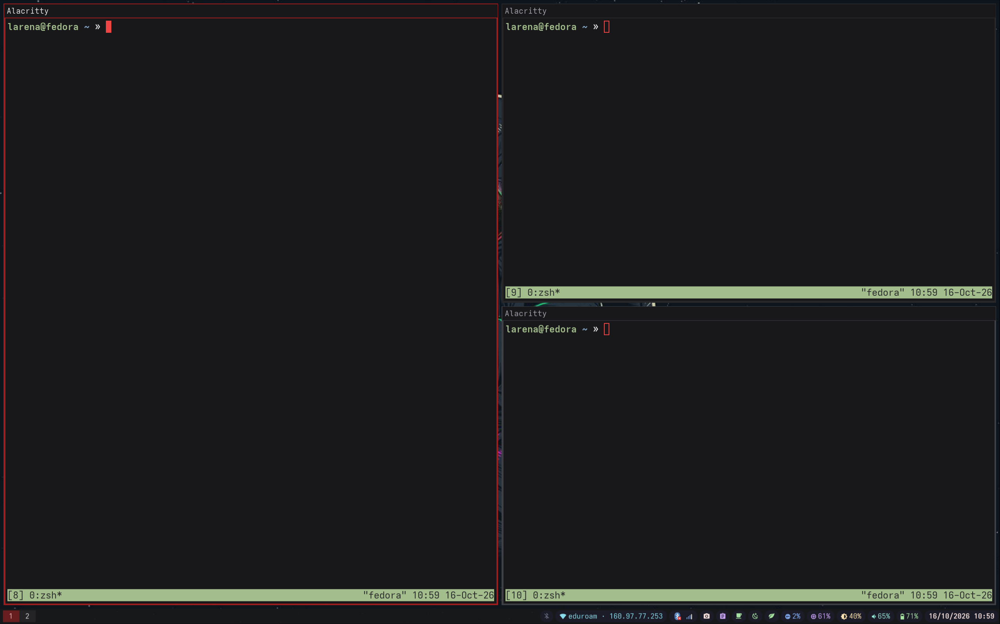
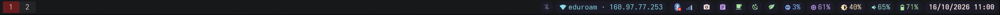
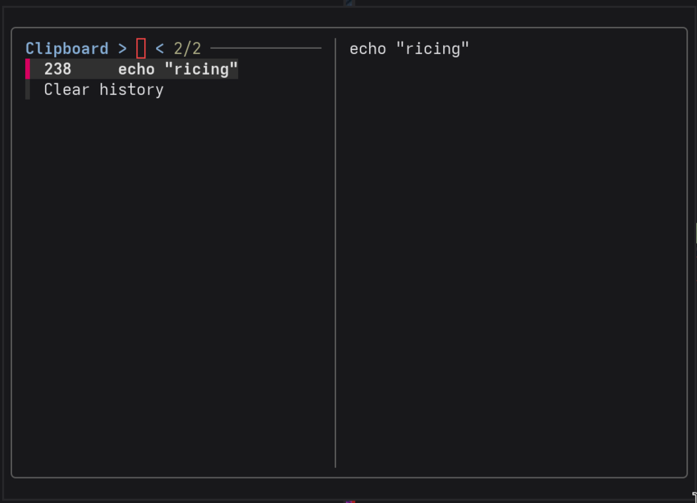
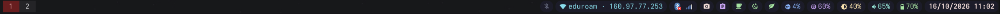
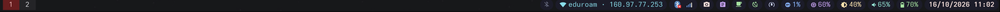
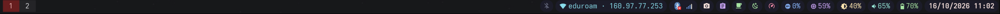

# m1rice-sway

A personal Sway desktop setup for a MacBook Air M1 running Fedora-based Asahi Linux, with Alacritty, Waybar, and custom desktop scripts.

This repository provides the packages, base configuration, and dotfiles for a lightweight Wayland desktop on Apple Silicon.



## Features

### Waybar



A bottom bar with workspace navigation on the leftand system controls on the right.

- Clickable Sway workspaces and an indicator for the current binding mode.
- Bluetooth status, connected device names, and device battery levels when available. Click to open Blueman.
- Network status with Wi-Fi SSID and IP address, plus signal and gateway information in the tooltip. Click to open the connection editor.
- System tray.
- Screenshot and clipboard-history buttons.
- Separate controls for idle inhibition and sleep inhibition.
- A clickable TuneD power-profile indicator.
- CPU and memory usage refreshed every three seconds.
- Backlight percentage with five-percent scroll adjustments.
- Audio volume with five-percent scroll steps.
- Battery status, charging indicators, and remaining-time information, with warning and critical thresholds at 30% and 15%.
- Date and time with a calendar tooltip.

### Screenshots

Click the screenshot button to select an area with `slurp`, capture it with `grim`, and open it in Swappy for annotation and saving. Press Escape during selection to cancel.

### Clipboard history



Click the clipboard button to open an `fzf` picker in Alacritty:

- Search history and preview entries.
- Select an entry to copy it back to the clipboard.
- Choose **Clear history** and confirm to wipe the history and clear the current clipboard.
- If the clipboard window already exists, clicking the button focuses it instead of opening another one.

Clipboard collection is started by Sway with `wl-paste --watch cliphist store`.

### Power profiles

| Profile | Indicator |
| --- | --- |
| Powersave |  |
| Balanced |  |
| Throughput performance |  |

Click the power-profile indicator to cycle through:

```text
powersave → balanced → throughput-performance → powersave
```

The indicator uses a different icon for each profile and refreshes every five seconds.

### Idle behavior

After five minutes of inactivity, Sway locks the screen with a black `swaylock` screen. After another five minutes, it turns off the displays; they turn back on when activity resumes. The screen is also locked before suspend.

## Keyboard shortcuts

`Mod` is `Mod4` (the Command key on the MacBook keyboard).

### Applications and session

| Shortcut | Action |
| --- | --- |
| `Mod + Enter` | Open Alacritty |
| `Mod + Space` | Open the application launcher |
| `Mod + Shift + Q` | Close the focused window |
| `Mod + C` | Open or focus clipboard history |
| `Mod + P` | Select a screenshot region and open it in Swappy |
| `Mod + Shift + C` or `Mod + Shift + R` | Reload the Sway configuration |
| `Mod + Shift + E` | Show the logout confirmation |
| `Mod + Shift + S` | Show the suspend confirmation |
| `Mod + Shift + B` | Show the reboot confirmation |
| `Mod + Shift + P` | Show the power-off confirmation |

### Navigation and workspaces

| Shortcut | Action |
| --- | --- |
| `Mod + Arrow keys` | Focus the window in that direction |
| `Mod + Shift + Arrow keys` | Move the focused window in that direction |
| `Mod + 1–9` | Switch to workspace 1–9 |
| `Mod + 0` | Switch to workspace 10 |
| `Mod + Shift + 1–9` | Move the focused window to workspace 1–9 |
| `Mod + Shift + 0` | Move the focused window to workspace 10 |
| `Mod + A` | Focus the parent container |

### Layout and window management

| Shortcut | Action |
| --- | --- |
| `Mod + H` | Set a horizontal split |
| `Mod + V` | Set a vertical split |
| `Mod + S` | Use the stacking layout |
| `Mod + W` | Use the tabbed layout |
| `Mod + E` | Toggle the split layout |
| `Mod + F` | Toggle fullscreen |
| `Mod + Shift + F` | Toggle floating mode |
| `Mod + Shift + Space` | Switch focus between tiled and floating windows |
| `Mod + Shift + Minus` | Move the focused window to the scratchpad |
| `Mod + Minus` | Show or cycle scratchpad windows |
| `Mod + Left mouse drag` | Move a window using the floating modifier |
| `Mod + Right mouse drag` | Resize a window using the floating modifier |
| `Mod + R` | Enter resize mode |
| `Arrow keys` in resize mode | Resize in 10-pixel steps |
| `Enter` or `Escape` in resize mode | Leave resize mode |

### Hardware keys

| Key | Action |
| --- | --- |
| Volume up / down | Adjust the default output volume by 5% |
| Audio mute | Toggle output mute |
| Microphone mute | Toggle input mute |
| Brightness up / down | Adjust brightness by 5% |

Hardware-key bindings use `--locked`, so they are available while locked, provided the keyboard generates the corresponding key symbols.

## Requirements

- A MacBook Air with Apple M1 running Fedora-based Asahi Linux
- An account with `sudo` access
- A working graphical session or console for initial setup

## Update the system

```sh
sudo dnf upgrade --refresh
```

## Install Sway

```sh
sudo dnf install sway foot wmenu swaybg swayidle swaylock waybar
```

## Configure SDDM

Install SDDM without weak dependencies:

```sh
sudo dnf install sddm --setopt=install_weak_deps=False
```

Enable SDDM and select graphical boot:

```sh
sudo systemctl enable sddm.service -f
sudo systemctl set-default graphical.target
```

> Enabling SDDM with `-f` can replace the existing display-manager link. Skip this step if you want to retain another login manager.

## Install supporting applications

```sh
sudo dnf install nano wget gpg curl git \
  zip unzip p7zip p7zip-plugins \
  alacritty tmux zsh tealdeer fzf \
  NetworkManager NetworkManager-wifi NetworkManager-tui \
  network-manager-applet blueman \
  wdisplays nemo nemo-fileroller evince feh brightnessctl \
  j4-dmenu-desktop bemenu btop pavucontrol
```

Install the fonts and screenshot/clipboard tools:

```sh
sudo dnf install nerd-fonts
sudo dnf install grim slurp swappy wl-clipboard cliphist
```

`btop` and `pavucontrol` are used by the CPU, memory, and audio click actions. The network button runs `nm-connection-editor`; make sure that command is available on your installation.

## Configure power profiles

```sh
sudo dnf install tuned-ppd
```

Check the available profiles and the active profile:

```sh
tuned-adm list
tuned-adm active
command -v tuned-adm
```

The scripts expect the profiles `powersave`, `balanced`, and `throughput-performance`. Confirm that they exist before enabling the click action.

For passwordless switching from Waybar, create a dedicated sudoers drop-in:

```sh
sudo visudo -f /etc/sudoers.d/tuned-profiles
```

Replace `YOUR_USERNAME` with your local username and verify the executable path before adding:

```sudoers
YOUR_USERNAME ALL=(root) NOPASSWD: /usr/sbin/tuned-adm profile powersave, /usr/sbin/tuned-adm profile balanced, /usr/sbin/tuned-adm profile throughput-performance
```

After saving and exiting the editor, validate the configuration:

```sh
sudo visudo -c
```

> Keep this rule limited to the exact profile commands. Do not grant unrestricted passwordless access to `tuned-adm` or a shell.

## Install the dotfiles

```sh
git clone https://github.com/larena14/m1rice-sway.git
cd m1rice-sway
```

The repository uses `config/`; the installation destination remains `~/.config/`.

Back up existing Alacritty, Sway, and Waybar configurations before replacing them. Run the following commands from the repository root:

```sh
mkdir -p ~/.config
cp -r config/alacritty ~/.config/
cp -r config/sway ~/.config/
cp -r config/waybar ~/.config/
chmod +x ~/.config/waybar/scripts/*.sh
```

Alternatively, after moving existing destination directories out of the way, use symbolic links instead of copying:

```sh
mkdir -p ~/.config
chmod +x config/waybar/scripts/*.sh
ln -s "$(pwd)/config/alacritty" ~/.config/alacritty
ln -s "$(pwd)/config/sway" ~/.config/sway
ln -s "$(pwd)/config/waybar" ~/.config/waybar
```

Use either copying or symbolic links, not both.

The supplied Waybar configuration is stored as `config/waybar/config`. If working from the uploaded `config.json`, rename it to `config` when adding it to the repository.

Reload Sway from the running session:

```sh
swaymsg reload
```

Restart Waybar separately if it does not pick up configuration changes.

## Script overview

- `screenshot.sh`: selects a region and opens the capture in Swappy.
- `clipboard.sh`: opens the clipboard window, or focuses the existing one using the `waybar-clipboard` app ID.
- `clipboard-menu.sh`: provides the history picker, preview, copy action, and confirmed history wipe.
- `tuned-cycle.sh`: switches to the next TuneD profile using `sudo`.
- `tuned-label.sh`: prints an icon for the active TuneD profile.

## Integration notes

### Screenshot saving

The screenshot script creates a `Screenshots` directory under `${XDG_PICTURES_DIR:-$HOME/Pictures}` and builds a timestamped filename, but it does not pass that filename to the capture or editor. Saving is handled through Swappy; the script does not automatically save to the generated path.

### Idle and sleep inhibition

The idle inhibitor is configured to start activated. The bar also includes a separate sleep inhibitor. These controls request inhibition; their effect on automatic locking, display power-off, or suspend depends on the session and system configuration.

### Power-profile detection

The power scripts parse the English `Current active profile:` output from `tuned-adm active`. If profile icons or switching do not behave as expected, check the command output and locale. The desktop tooltip uses “performance” as shorthand; the script selects `throughput-performance`.

## Screenshots

| File | Shows |
| --- | --- |
| `assets/desktop.png` | Full desktop with wallpaper, Waybar, and tiled windows |
| `assets/waybar.png` | Waybar modules and styling |
| `assets/clipboard.png` | Clipboard history picker |
| `assets/power-powersave.png` | TuneD powersave indicator |
| `assets/power-balanced.png` | TuneD balanced indicator |
| `assets/power-performance.png` | TuneD throughput-performance indicator |

## Useful guides

The [`guides/`](guides/) directory contains optional guides for additional system configuration:

- [Btrfs snapshots with Snapper](guides/SNAPSHOT_BTRFS.md)
- [ZRAM configuration](guides/ZRAM.md)

These guides are separate from the desktop setup instructions.

## Repository layout

```text
.
├── assets
│   ├── clipboard.png
│   ├── desktop.png
│   ├── power-balanced.png
│   ├── power-performance.png
│   ├── power-powersave.png
│   ├── screenshot.png
│   └── waybar.png
├── config
│   ├── alacritty
│   │   ├── alacritty.toml
│   │   └── theme.toml
│   ├── sway
│   │   ├── astronaut.jpg
│   │   ├── config
│   │   └── CREDITS.md
│   └── waybar
│       ├── config
│       ├── scripts
│       │   ├── clipboard-menu.sh
│       │   ├── clipboard.sh
│       │   ├── screenshot.sh
│       │   ├── tuned-cycle.sh
│       │   └── tuned-label.sh
│       └── style.css
├── guides
│   ├── SNAPSHOT_BTRFS.md
│   └── ZRAM.md
├── LICENSE
└── README.md
```

## Optional: Italian keyboard layout

Configure the X11 default and virtual-console layout:

```sh
sudo localectl set-x11-keymap it pc105
sudo localectl set-keymap it
```

To apply the console map immediately, run this from a virtual console:

```sh
sudo loadkeys it
```

For Sway, uncomment the keyboard block in `config/sway/config`:

```sway
input type:keyboard {
    xkb_layout "it"
    xkb_model "pc105"
}
```

Reload Sway to apply the change.

## Credits

Wallpaper collection: [D3Ext/aesthetic-wallpapers](https://github.com/D3Ext/aesthetic-wallpapers).

See [wallpaper credits](config/sway/CREDITS.md) for provenance and licensing notes.

## License

Original contributions to this project are licensed under the [MIT License](LICENSE).

Third-party files retain their original copyright notices and applicable licenses.
